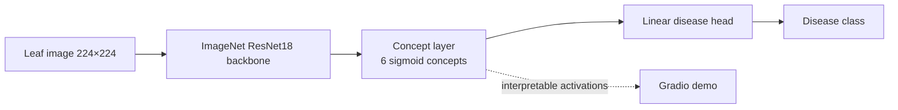

<div align="center">

# Crop Disease Concept Network

### Concept Bottleneck transfer learning for leaf-disease classification

*ResNet18 → 6 visual symptom concepts → disease class. Interpretable middle layer, measurable against a plain ResNet18 baseline.*


</div>

---

## Problem

Crop-disease classifiers that only emit a class label are hard to trust in the field. A **Concept Bottleneck Network (CBN)** forces the model through human-interpretable symptom concepts (rust patches, brown spots, yellowing, …) before the disease head — so an agronomist can see *why* the model picked a class.

## Architecture



**Design decisions / trade-offs**

| Decision | Why | Trade-off |
|---|---|---|
| Concept bottleneck (not end-to-end logits only) | Inspectable symptom scores; assignment requirement | Harder to optimize; early-epoch accuracy lags a plain ResNet18 |
| Weak concept supervision from class name heuristics | No pixel-level concept labels in PlantVillage | Noisy concept targets |
| Images **not** in git | Repo was ~1 GB / 42.7k files; clone/CI was unusable | Must run `scripts/download_data.py` or demo data |
| Subset CPU eval checked in | Honest, reproducible numbers without a GPU | Not a full-dataset claim — labelled as such |

---

## Results (measured)

**Protocol (this PR):** PlantVillage `Train/` → 10 classes × max 30 images/class → 225 train / 75 val · **3 epochs · CPU · batch 8**.  
Reproduce: `python eval/train_compare.py --data-dir data/raw --max-per-class 30 --max-classes 10 --epochs 3 --out outputs/subset_cpu`

| Model | Val accuracy | Macro-F1 |
|---|---|---|
| **Plain ResNet18 baseline** | **0.933** | **0.930** |
| Concept Bottleneck (ResNet18 → 6 concepts) | 0.240 | 0.126 |

Confusion matrices: [`eval/published/confusion_baseline.png`](eval/published/confusion_baseline.png) · [`eval/published/confusion_cbn.png`](eval/published/confusion_cbn.png).

**How to read this.** On a 3-epoch CPU subset the plain ResNet18 is clearly ahead — expected, because the CBN is optimizing an extra concept loss with weak labels. The CBN’s value is **interpretability** (concept activations in the Gradio app), not beating the baseline in three epochs. Full-dataset GPU runs (no `--max-per-class` cap, ≥15 epochs) are **TBD** — re-run and replace `eval/published/summary.json`.

---

## Data (images are gitignored)

This branch **stops tracking** the previously committed `Plant Village Dataset/` (~42.7k images). History is unchanged (no rewrite); new clones will not carry the blob.

```bash
# Option A — PlantVillage already on disk / re-downloaded
python scripts/download_data.py --from-plantvillage "Plant Village Dataset/Train" --out data/raw

# Option B — Kaggle 14-class crop disease set
python scripts/download_data.py --kaggle snikhilrao/crop-disease-detection-dataset --out data/raw

# Option C — synthetic smoke data (CI)
python scripts/create_demo_data.py --output-dir data/demo --images-per-class 8
```

---

## Quickstart

```bash
python -m venv .venv && source .venv/bin/activate
pip install -r requirements.txt

# train + compare (subset)
python eval/train_compare.py --data-dir data/raw --max-per-class 30 --max-classes 10 --epochs 3 --out outputs/subset_cpu

# Gradio demo (needs outputs/subset_cpu/best_cbn.pt)
python app.py

# tests
pytest -q tests
```

### CI

Template: [`ci/github-actions.yml`](ci/github-actions.yml) — copy to `.github/workflows/ci.yml` (token lacked `workflow` scope).

---

## Tech stack

PyTorch · torchvision ResNet18 · scikit-learn metrics · Gradio · pytest

---

## License

MIT — dataset subject to Kaggle / PlantVillage terms.
